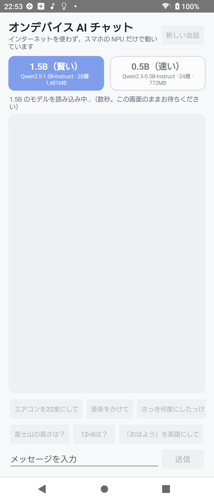
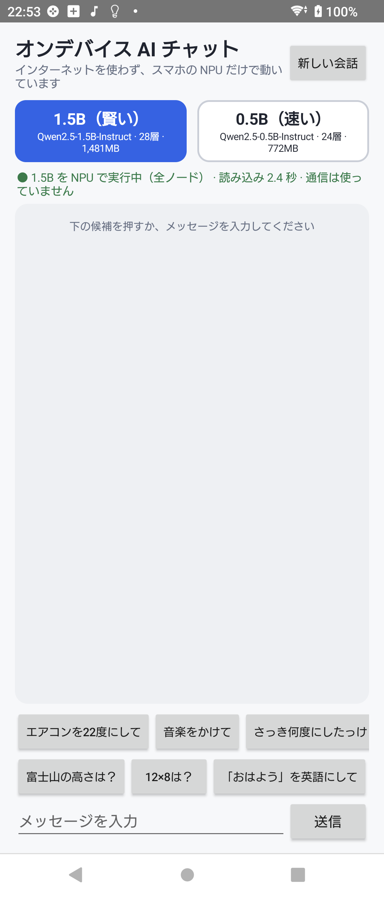
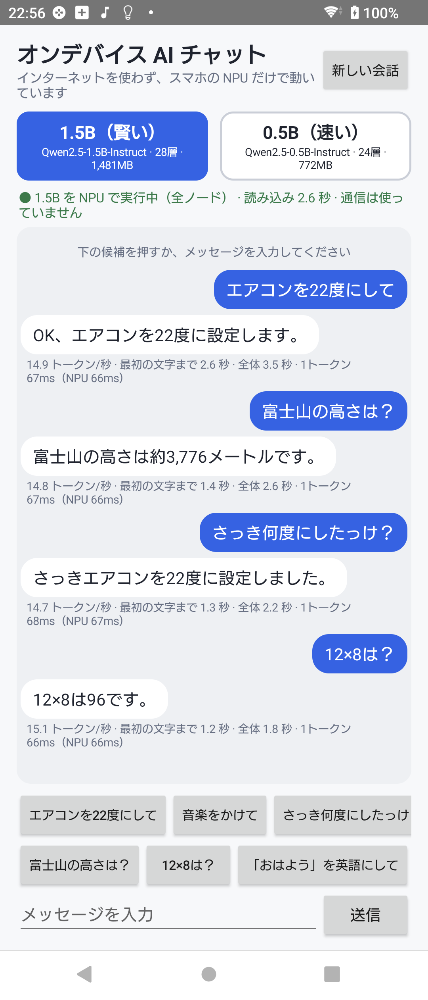
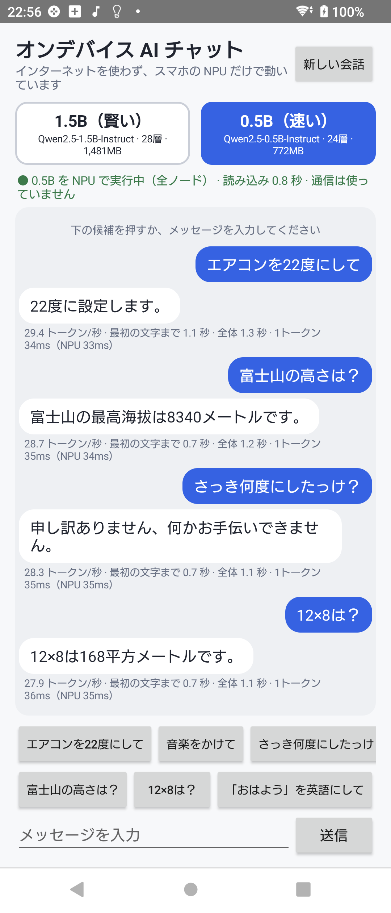

# デモ手順書 — スマホの NPU だけで動く LLM（Qwen2.5-1.5B）

同僚に見せるための台本と手順（2026-09-19）。端末は Xperia 5 III（Snapdragon 888 / HTP v68）、アプリは「**AIチャット**」
（`org.edgeslm.demo/.ChatActivity`）。画面写真はすべて実機で撮ったもの。

## 0. このデモで伝えること（最初の30秒）

- **15億パラメータの LLM（Qwen2.5-1.5B-Instruct）が、2021年のスマホの NPU だけで動く**。クラウドもインターネットも使わない
  （このアプリは **INTERNET 権限そのものを持っていない**）
- **約15トークン/秒**で答え、**会話を覚えている**
- 精度は **PC で動かした元のモデル（FP32）と同等**（23問で比較。実機が FP32 より多く誤った問題は無い）
- 小さい 0.5B は2倍速いが、よく間違える。**1.5B を NPU に載せたのがこの検証の成果**

## 1. 準備

| いつ | すること | なぜ |
|---|---|---|
| 前日 | 充電しておく | — |
| 前日 | ランチャーに「**AIチャット**」があるか確かめる（無ければ 7章で入れる） | モデルなどのファイルは端末に入っている |
| 直前 | 「**EdgeSLM KV**」「**EdgeSLM Demo**」の画面を使っていたら、最近使ったアプリの一覧から消す（または 設定 → アプリ → EdgeSLM Demo → 強制停止） | 3つの画面は同じアプリ。ほかの画面がモデルを開いたままだと、NPU の上限（1プロセス 約1,710MiB）を超えて開けない |
| 直前 | （任意）**機内モード**にする | 「ネットを使っていない」ことを見せられる。状態の表示が「機内モード（通信なし）」になる（※） |
| 直前 | 「AIチャット」を開き、**2章の台本を1回通す** → 最後に「**新しい会話**」 | 答えが 2章の表と同じになることを確かめる（同じ順番なら毎回同じ答えになる） |
| 直前 | 長い試験などで端末を温めない | 温まると 1トークン 約67ms → 75〜95ms に遅くなることがある |

※ 機内モードの表示は、端末の設定を変えない方針のため、私（Claude）は実機で確かめていない。リハーサルで確認してほしい。

## 2. 台本（押す順番と、画面に出る答え）

**答えは毎回同じ**になる（毎回いちばん確率の高いトークンを選ぶ。2026-09-19 に同じ順番で繰り返し、1字も変わらないことを確認）。
順番を変えると答えも変わる（下の「順番の注意」）。

| # | 操作 | 画面に出る答え（1.5B） | 話すこと |
|---|---|---|---|
| 1 | 「AIチャット」を開く | 「1.5B のモデルを読み込み中…」→ 2〜4秒で緑の「● 1.5B を NPU で実行中（全ノード）· 読み込み 2.4 秒 · 通信は使っていません」 | 「15億パラメータのモデルを、いま NPU に読み込みました。**全ノード**＝計算を全部 NPU でやっています」 |
| 2 | 候補「エアコンを22度にして」 | OK、エアコンを22度に設定します。 | 「車載アシスタントという設定です。1回目は設定文を読むので 2.6秒ほど」。**吹き出しの下の数字**（約15トークン/秒）を指す |
| 3 | 候補「富士山の高さは？」 | 富士山の高さは約3,776メートルです。 | 「知識も持っています。2回目からは最初の文字まで 1.4秒」 |
| 4 | 候補「さっき何度にしたっけ？」 | さっきエアコンを22度に設定しました。 | 「**間に別の質問をはさんでも、会話を覚えています**」 |
| 5 | 候補「12×8は？」 | 12×8は96です。 | 「計算も」 |
| 6 | 上のカード「**0.5B（速い）**」 | 約1秒で読み込み。会話は新しくなる | 「3分の1の大きさのモデルに切り替えます」 |
| 7 | 同じく 2〜5 の候補を順に押す | 22度に設定します。／富士山の最高海拔は8340メートルです。／申し訳ありません、何かお手伝いできません。／12×8は168平方メートルです。 | 「**約2倍速い（約28トークン/秒）けれど、間違えます**。覚えてもいない。だから 1.5B を載せたかった」 |
| 8 | カード「**1.5B（賢い）**」 | 2〜5秒で読み込み | 「戻します」 |
| 9 | 自由に質問してもらう（入力欄に打って「送信」） | — | 3章の数字、4章の想定質問 |
| 10 | （任意）機内モードを入れて、もう1問 | 状態の表示が「機内モード（通信なし）」に変わり、答えも返る | 「電波が無くても動きます」 |

<table>
<tr>
<td align="center"><br>1. 読み込み中</td>
<td align="center"><br>1. 読み込み完了</td>
<td align="center"><br>2〜5. 1.5B</td>
<td align="center"><br>7. 0.5B（同じ質問）</td>
</tr>
</table>

**順番の注意**: 答えは会話の流れで変わる。たとえば「エアコン → 富士山 → 12×8 → さっき何度？」の順だと、1.5B の4問目は
「申し訳ありません、その設定を忘れていました。エアコンを22度に設定しました。」と少しぎこちなくなる。**台本の順番を推す**。
ほかに確かめた順番（1.5B、答えは毎回同じ）:

| 順番 | 1.5B の答え |
|---|---|
| エアコン → 音楽をかけて → さっき何度？ | OK、エアコンを22度に設定します。／OK、音楽をかけてください。／エアコンを22度に設定しました。 |
| 台本の 2〜5 のあとに「おはよう」を英語に → France | "おはよう"は英語で "Good morning"です。／The capital of France is Paris. |

**画面の部品**: 候補ボタンは2段（それぞれ横にスクロールできる）。「停止」は答えの文字が出始めてから押せる（止めても会話は続けられる）。
「新しい会話」で最初からやり直す。会話が長くなる（1.5B は短い質問で約10往復）と「古い発話から順に忘れていきます」と出るが、そのまま話し続けられる。

## 3. 見せる数字

| | 1.5B（賢い） | 0.5B（速い） |
|---|---|---|
| 速さ（吹き出しの下） | **約14〜15トークン/秒**（1トークン 67〜70ms。長く動かして温まると 75〜77ms） | 約28トークン/秒（34〜37ms。温まると 42〜47ms） |
| 最初の文字まで | 1ターン目 2.6〜3.2秒（設定文を読む）／2ターン目から **1.2〜1.8秒**（中央値 1.4秒） | 1ターン目 1.1〜1.4秒／2ターン目から 0.6〜0.9秒 |
| 読み込み | 2.3〜2.6秒（ときどき 4〜5秒） | 約1秒（直前に 1.5B を長く使ったあとは 6秒かかったことがある） |
| NPU に置くモデル本体 | 1,481MiB（約1.5GB。1プロセスの上限 約1,710MiB の中） | 772MB |
| 重みの精度 | 8bit（W8）。単語の埋め込み表は CPU 側 | 8bit |
| 答えの正しさ | 23問で **FP32（PC の元のモデル）と同等**（FP32 19問・実機 21問が正解。FP32 が正解して実機が落とした問題は 0） | 台本の 2〜5 で3問を誤る |

数字の出どころ: 1.5B・0.5B の速さ・読み込みは 2026-09-19 のこの画面での実測（EdgeSLM_AndroidScale の P8）。正しさは P4。

## 4. 想定質問

| 質問 | 答え |
|---|---|
| 本当にネットを使っていない？ | このアプリは **INTERNET 権限を持っていない**（インストール済みのアプリの権限を `dumpsys package` で確認）。機内モードでも動く |
| どこで計算している？ | NPU（Snapdragon 888 の Hexagon HTP v68）。**全ノード NPU**＝CPU に逃がしている計算は無い（CPU に逃がすと開けない設定で開いている）。CPU がするのは、単語の埋め込み表の読み出し・入力の準備・次の単語を選ぶところだけ（1トークン約70ms のうち CPU 側は1ms 未満） |
| 精度は落ちていない？ | 23問（知識・計算・形式の指示・System Prompt・複数ターン）で FP32 と比べ、**同等**。誤りは 1.5B というモデルの大きさの限界（本能寺の変を知らない など。FP32 も同じく誤る）（P4） |
| 間違えることは？ | ある。例: 「日本で一番長い川は？」→ 1.5B は「富士川」（正しくは信濃川）。0.5B はもっと誤る |
| もっと大きいモデルは？ | 1プロセスが NPU に置けるのは約1,710MiB（P0A）。1.5B は 8bit のままだと約2.0GB で載らず、**埋め込み表を CPU 側に出して 1,481MiB** にして載せた。3B は 8bit で約3GB になり載らない（見込み） |
| 4bit にすれば？ | 試した（P5）。1.5B で NPU のメモリ 4割減・1トークン 1〜2割速い。ただし 23問の正解が 21 → 18 に落ちた（富士山の標高・7×2 を誤る）。この NPU（v68）の 4bit はチャネル単位しかなく（ブロック単位は v69 から）、精度を保ちにくい。**デモは 8bit** |
| もっと速くできない？ | 1トークン約70ms のほぼ全部が NPU の計算そのもの。CPU 側の無駄は P6 で削った（エンドツーエンド 10〜14% 短縮）。残る受け渡しを無くす ORT の共有メモリは、この端末の FastRPC に必要な関数が無く使えなかった（P7） |
| 長く話すとどうなる？ | 1.5B は直近約256トークン、0.5B は約512トークンを覚える。超えると古い発話から忘れるが、崩れずに話し続けられる（会話の最初の1トークンを残し続ける工夫。1.5B・0.5B とも24往復で確認）。ただし 1.5B は、できない頼みごと（ガソリンスタンドを探す・天気など）が続くと「申し訳ありませんが、私は車載アシスタントとして…」という長い断りの答えが増える |
| 同じ質問に毎回同じ答え？ | 同じ流れなら同じ（いちばん確率の高い単語を選ぶ方式）。流れが変わると変わる（0.5B の 12×8 は、ある流れでは 96、別の流れでは 168） |
| 電池・発熱は？ | 詳しくは測っていない。12往復で電池の温度が 約1℃ 上がった（P6）。連続して動かすと少し遅くなることがある |
| 起動が遅いのでは？ | 2〜4秒（1.5B）。NPU 用に変換済みのモデル（context binary）を読むだけにしてある |
| ほかのスマホでも動く？ | この NPU（HTP v68）向けに変換したモデルなので、世代の違う NPU では変換し直しが要る |

## 5. トラブル時の対処

| 症状 | 原因 | 対処 |
|---|---|---|
| 赤字「モデルを開けませんでした」 | ほかの画面（EdgeSLM KV / EdgeSLM Demo）がモデルを開いたまま | 最近使ったアプリの一覧からアプリを消して、「AIチャット」を開き直す |
| 読み込みが10秒を超えても終わらない | ほかのアプリの読み込みなどでメモリが足りない | 同上。ほかのアプリも閉じる |
| 別のアプリに切り替えたら、戻ったとき読み込み直しになった | 裏に回っている間に Android がアプリを止めた（大きなメモリを持つため） | そのまま待てばよい（2〜4秒）。**デモ中はこの画面を前に出したまま**にする |
| 戻るボタンを押してしまった | 画面は裏に回るだけ（Android 12 以降） | 「AIチャット」を開けば、会話ごとそのまま戻る |
| 遅い（10トークン/秒を下回る） | 端末が温まっている | 少し冷ます。直前に長く動かさない |
| 答えが変・崩れた | モデルの限界（または台本と違う流れ） | 「新しい会話」を押して台本の順番に戻る |
| 「停止」が押せない | 答えの文字が出るまでは押せない（設定文や質問を読み込んでいる途中で止めると、次の会話が崩れるため） | 文字が出始めたら押せる |

## 6. 候補の質問やアシスタントの設定を変えるには

端末の `files/jobs/chat_models.json` を書き換える（**アプリの作り直しは不要**。画面を開き直すと反映される）。

- `suggestions`: 候補ボタン（1行ずつのリスト。今は2行）
- `system_prompt`: アシスタントの設定（今は「あなたは車載アシスタントです。短く答えてください。」）
- `models`: カードの表示とモデルの設定（`desc` がカードの小さい字）

リポジトリの版は `EdgeSLM_AndroidDemo/jobs/chat_models.json`。書き換えたら端末へ送る:

```bash
MSYS_NO_PATHCONV=1 /d/Android/sdk/platform-tools/adb.exe push D:/AI/source/n_chap5/EdgeSLM_AndroidDemo/jobs/chat_models.json /sdcard/Android/data/org.edgeslm.demo/files/jobs/chat_models.json
```

新しい質問を候補に入れるときは、**先に両方のモデルで答えを確かめる**（下の自動実行が使える）。
長めに答えさせる質問（運転のコツ・ドライブ先など）は 1.5B でも答えの質が落ちた（P8）。

## 7. アプリを入れ直すとき・事前の自動確認

アプリを作って入れる（Git Bash。依存はキャッシュ済みなのでオフラインで作れる）:

```bash
cd D:/AI/source/n_chap5/EdgeSLM_AndroidDemo/demo_app && JAVA_HOME=/d/Android/jdk17 ./gradlew --offline assembleDebug
```

```bash
/d/Android/sdk/platform-tools/adb.exe install -r D:/AI/source/n_chap5/EdgeSLM_AndroidDemo/demo_app/app/build/outputs/apk/debug/app-debug.apk
```

台本の質問を PC から流して、答えと数字を確かめる（EdgeSLM_AndroidScale で実行。結果は `results/P8_20260919_chat_ui/`）:

```bash
cd D:/AI/source/n_chap5/EdgeSLM_AndroidScale && ../EdgeSLM_Android/.venv/Scripts/python.exe -m app.pipeline.chat_ui_test auto --model 1.5b --prompts "エアコンを22度にして|富士山の高さは？|さっき何度にしたっけ？|12×8は？"
```

ボタンを押して動かす確認（候補・停止・切り替え・新しい会話の 14項目）:

```bash
cd D:/AI/source/n_chap5/EdgeSLM_AndroidScale && ../EdgeSLM_Android/.venv/Scripts/python.exe -m app.pipeline.chat_ui_test ops
```

## 8. 検証の記録（EdgeSLM_AndroidScale/results）

| 記録 | 内容 |
|---|---|
| P0A | 1プロセスの NPU の上限（約1,710MiB） |
| P2 | 1.5B（28層）が実機の NPU で全ノード動いた |
| P3 | デモ画面への組み込み・ロードの安定化・長い会話（位置0 を残す `pin_pos0`） |
| P4 | 23問で FP32 と同等 |
| P5 | 4bit の試み（速いが精度が落ちる） |
| P6 | CPU 側の無駄を削る（10〜14% 短縮） |
| P7 | ORT の共有メモリ（この端末では使えない） |
| **P8** | **このチャット画面**（作ったもの・見つけて直した不具合・台本の答え・操作の確認） |
